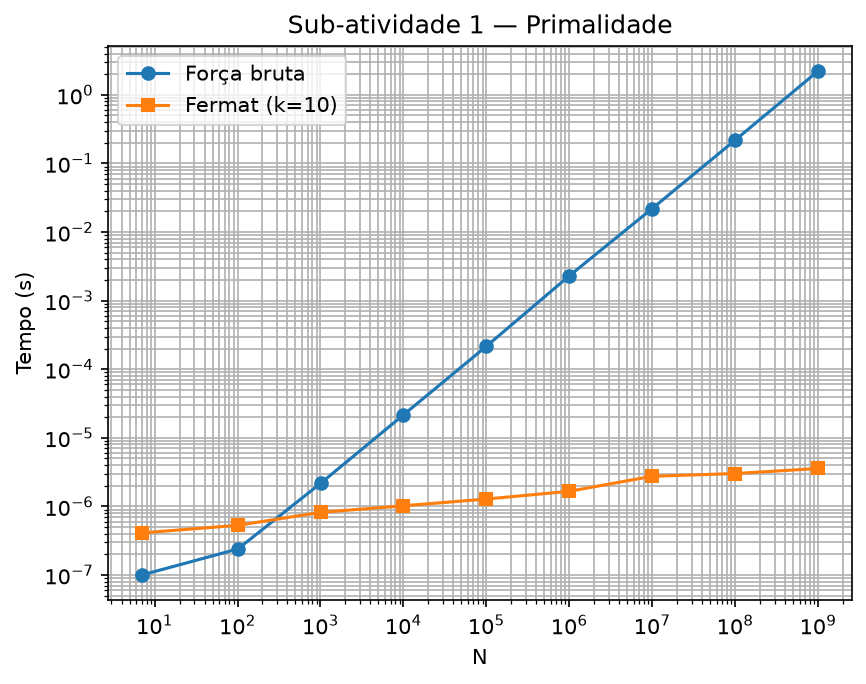
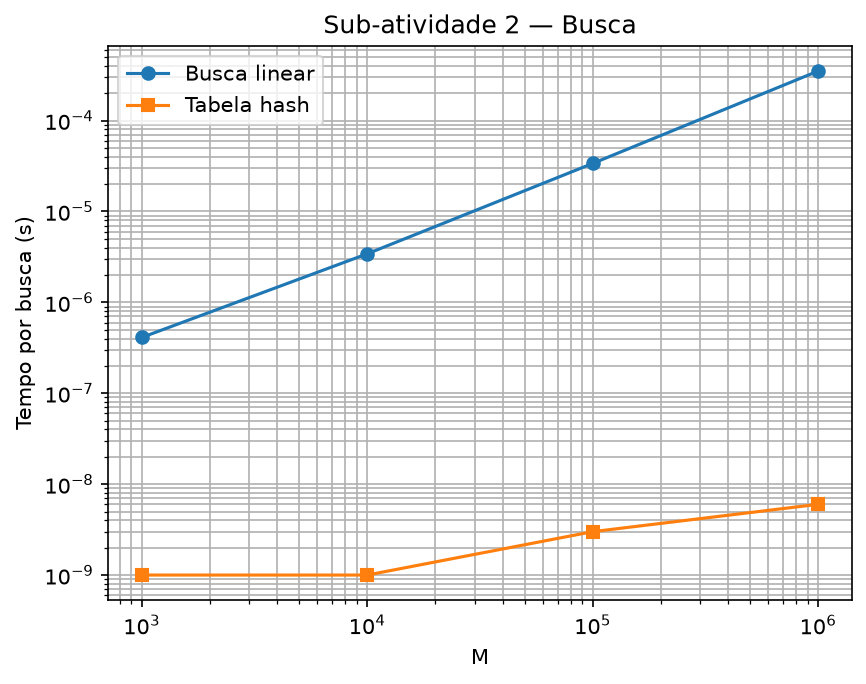
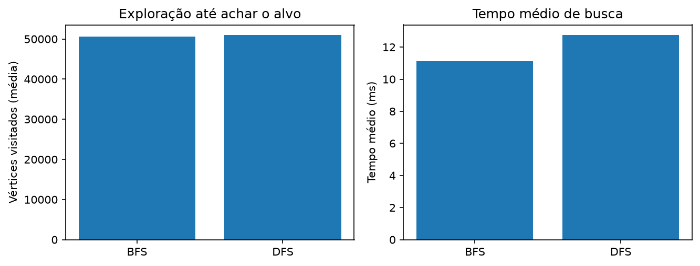

# NAP1 — Projeto e Análise de Algoritmos (UFRA/BSI)

Comparação experimental de três pares de algoritmos:

| Sub-atividade | Algoritmo A | Algoritmo B |
|---|---|---|
| 1 — Primalidade | Força bruta | Teste de Fermat (k=10) |
| 2 — Busca | Busca linear | Tabela hash (encadeamento) |
| 3 — Grafos | BFS | DFS |

**Disciplina:** Projeto e Análise de Algoritmos — UFRA/BSI
**Professor:** Gilberto N Souza Jr
**Autora:** Karla Geovanna Almeida de Sousa
**Local:** Paragominas — PA, Brasil

## Resultados principais

| Experimento | Resultado |
|---|---|
| Primalidade (N=10^9) | Fermat ~621 000x mais rápido que força bruta |
| Busca hash (M=10^6) | Hash ~58 000x mais rápida que busca linear |
| Grafos (n=10^5) | BFS 11,1 ms vs DFS 12,8 ms (ambos acham 100/100) |

## Gráficos





## Como rodar

```bash
make all       # compila
make bench     # gera results/*.csv
make figuras   # gera figures/*.png